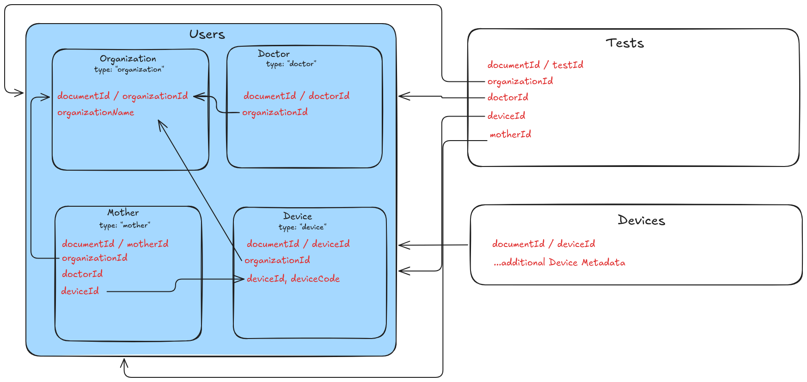

# Fetosense Database Schema

This document outlines the data structure used across the three Flutter apps (Device, Remote, and MIS) on Appwrite Document DB.

## Overview

Document DB is schemaless, so none of these fields are strictly enforced at the database level. This document exists as a reference for what the apps actually read and write.

* **Database ID:** `fetosense`

* **Collections:** `users`, `devices`, `tests`

* **Optional fields:** Different apps write different kinds of documents into the same collection, so any given document will only contain the fields relevant to it.

* **Dates (`createdOn`):** Standardized to ISO-8601 datetime strings across all collections and apps. (The Remote app currently writes `createdOn` as epoch milliseconds and will be updated to match.)

## 1. `users`

Collection ID: `users`

This is the main collection. It holds doctors, mothers, organizations, device-user records, and notifications all in one place. The `type` field distinguishes what kind of record a document represents.

### Basic Account Fields

| Field | Type | Notes |
| ----- | ----- | ----- |
| `type` | String | Identifies the record kind (shared by users and notifications) |
| `name` | String |  |
| `email` | String |  |
| `mobileNo` | Integer |  |
| `uid` | String |  |
| `documentId` | String |  |
| `delete` | Boolean | Soft-delete flag |
| `createdBy` | String |  |
| `createdOn` | Datetime (ISO-8601) |  |
| `autoModifiedTimeStamp` | Datetime (ISO-8601) |  |
| `modifiedAt` | Datetime (ISO-8601) |  |
| `modifiedTimeStamp` | String |  |

### Organization Fields

Used mainly by the MIS app when registering or managing organizations.

| Field | Type |
| ----- | ----- |
| `organizationId` | String |
| `organizationName` | String |
| `status` | String |
| `designation` | String |
| `contactPerson` | String |
| `addressLine` | String |
| `state` | String |
| `city` | String |
| `country` | String |
| `noOfDevices` | Integer |
| `noOfMother` | Integer |
| `noOfTests` | Integer |

### Doctor & Mother Fields

| Field | Type | Notes |
| ----- | ----- | ----- |
| `doctorId` | String |  |
| `doctorName` | String |  |
| `patientId` | String |  |
| `age` | Integer |  |
| `weight` | Float |  |
| `lmp` | Datetime (ISO-8601) | Last menstrual period |
| `edd` | Datetime (ISO-8601) | Estimated due date |
| `gAge` | Integer | Gestational age |

### Device & App Metadata

| Field | Type |
| ----- | ----- |
| `deviceId` | String |
| `deviceName` | String |
| `deviceCode` | String |
| `appVersion` | String |
| `isActive` | Boolean |
| `lastSeenTime` | String |
| `notificationToken` | String |
| `testAccount` | Boolean |
| `sync` | Integer |
| `platformId` | String |
| `platformRegAt` | String |

### AMC & JSON-Encoded Fields

| Field | Type | Notes |
| ----- | ----- | ----- |
| `amcStartDate` | String |  |
| `amcValidity` | String |  |
| `amcLog` | Array of Strings |  |
| `associations` | String | Stored as a JSON-encoded string |
| `bulletin` | String | Stored as a JSON-encoded string |

*Note: `amcPayment` is typed as dynamic in the app code, so it is left out here until its exact shape is confirmed.*

### Notification Fields

Notifications are also stored in `users` (wired up in `locater.dart`). They reuse `type` along with these fields:

| Field | Type | Notes |
| ----- | ----- | ----- |
| `userId` | String | Target user |
| `isShownInList` | Boolean |  |
| `isRead` | Boolean |  |
| `createdAt` | Datetime (ISO-8601) |  |
| `module` | String |  |
| `title` | String |  |
| `body` | String | Called `message` in the app model, stored as `body` in the DB |
| `imageUrl` | String | URL |
| `link` | String | URL |

## 2. `devices`

Collection ID: `devices`

Stores registered monitoring hardware. The first four fields are shared across the Device and MIS apps; the rest come from MIS registration and device table views.

| Field | Type | Notes |
| ----- | ----- | ----- |
| `deviceCode` | String |  |
| `deviceName` | String |  |
| `organizationId` | String |  |
| `hospitalName` | String |  |
| `tabletSerialNumber` | String | Added by MIS registration |
| `productType` | String | Added by MIS registration |
| `tocoId` | String | Added by MIS registration |
| `isValid` | Boolean | Added by MIS registration |
| `documentId` | String |  |
| `createdOn` | Datetime (ISO-8601) |  |

## 3. `tests`

Collection ID: `tests`

Stores fetal monitoring test sessions, including relationships, summary scores, raw trace arrays, and interpretation details.

### Identification & Relationships

| Field | Type |
| ----- | ----- |
| `documentId` | String |
| `motherId` | String |
| `motherName` | String |
| `patientId` | String |
| `deviceId` | String |
| `deviceName` | String |
| `doctorId` | String |
| `doctorName` | String |
| `organizationId` | String |
| `organizationName` | String |
| `testById` | String |
| `type` | String |

### Measurements & Scores

| Field | Type | Notes |
| ----- | ----- | ----- |
| `weight` | Integer |  |
| `gAge` | Integer |  |
| `age` | Integer | Present in the app models, though currently omitted from `toJson()` |
| `fisherScore` | Integer |  |
| `fisherScore2` | Integer |  |
| `lengthOfTest` | Integer |  |
| `averageFHR` | Integer |  |

### Measurement Arrays

All of these are **Arrays of Integers** storing time-series readings from the monitoring session:

* `bpmEntries`

* `bpmEntries2`

* `mhrEntries`

* `spo2Entries`

* `baseLineEntries`

* `movementEntries`

* `autoFetalMovement`

* `tocoEntries`

### Interpretation & Status

| Field | Type | Notes |
| ----- | ----- | ----- |
| `live` | Boolean |  |
| `testByMother` | Boolean |  |
| `delete` | Boolean |  |
| `referral` | Boolean |  |
| `interpretationType` | String |  |
| `interpretationExtraComments` | String |  |
| `association` | String | Stored as a JSON-encoded string |
| `autoInterpretations` | String | Stored as a JSON-encoded string |
| `createdBy` | String |  |
| `createdOn` | Datetime (ISO-8601) |  |

### Media & Sync Fields

These exist on the test models, though some are not currently written by `toJson()`.

| Field | Type |
| ----- | ----- |
| `imageLocalPath` | String |
| `imageFirePath` | String |
| `audioLocalPath` | String |
| `audioFirePath` | String |
| `isImgSynced` | Boolean |
| `isAudioSynced` | Boolean |

## Indexes

These indexes match the actual queries run by the three apps. For composite indexes, field order and sort direction should match the queries.

| Collection | Fields |
| ----- | ----- |
| `users` | `email` |
| `users` | `mobileNo`, `type` |
| `users` | `type`, `name` |
| `users` | `type`, `organizationName` |
| `users` | `type`, `organizationId`, `createdOn` |
| `users` | `organizationId` |
| `users` | `doctorId` |
| `users` | `deviceCode` |
| `users` | `documentId` |
| `users` | `userId`, `isShownInList`, `createdAt` |
| `devices` | `deviceCode` |
| `devices` | `deviceName` |
| `devices` | `organizationId` |
| `devices` | `documentId` |
| `tests` | `motherName`, `createdOn` |
| `tests` | `organizationId`, `createdOn` |
| `tests` | `doctorId` |
| `tests` | `referral` |
